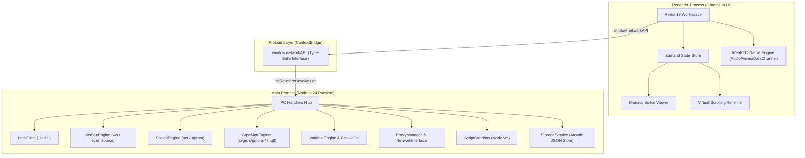

# Desain Sistem & Arsitektur Internal

Dokumen ini menguraikan arsitektur internal, pola desain perangkat lunak, jembatan komunikasi antar-proses (IPC), dan strategi optimasi performa pada **Network Tester GUI**.

---

## 🏛️ 1. Diagram Arsitektur Tingkat Tinggi

Aplikasi mengadopsi model multi-proses standar Electron yang memisahkan eksekusi jaringan backend dari antarmuka pengguna:

---

## 🔒 2. Batas Keamanan & Type-Safe ContextBridge

Sesuai dengan standar keamanan modern Electron:
1. **`nodeIntegration: false`**: Renderer process tidak memiliki akses langsung ke modul Node.js mentah (`fs`, `child_process`, `net`).
2. **`contextIsolation: true`**: Konteks JavaScript halaman web diisolasi dari skrip preload.
3. **`contextBridge.exposeInMainWorld('networkAPI', ...)`**: Seluruh fungsi backend hanya diekspos melalui objek `window.networkAPI` yang didefinisikan secara ketat pada [`src/preload/index.ts`](file:///d:/network-tools/src/preload/index.ts).

### Kontrak IPC:
- **Request / Response (`ipcRenderer.invoke`)**: Digunakan untuk eksekusi yang menghasilkan nilai balik (misal `http:execute`, `env:getAll`, `proxy:test`).
- **Streaming Events (`ipcRenderer.on`)**: Digunakan untuk aliran data asinkron berkelanjutan (misal paket TCP, frame WebSocket, datagram UDP, dan event MQTT).

---

## ⚡ 3. Strategi Optimasi untuk Hardware Rendah (Intel Celeron N4000)

Salah satu tantangan utama dalam membangun aplikasi jaringan desktop adalah menjaga responsivitas pada perangkat keras hemat daya dengan RAM terbatas (misal prosesor dual-core 1.09 GHz dan RAM 6 GB).

### Strategi yang Diterapkan:
1. **Zero C++ Build Tools & Native Compilation**:
   - Menghindari penggunaan pustaka yang membutuhkan kompilasi C++ (`node-gyp`) atau Rust. Seluruh pustaka adalah pure JavaScript/TypeScript.
   - Hasil: Instalasi cepat, tidak memicu *RAM thrashing* saat kompilasi, dan portabel di berbagai lingkungan.
2. **Virtual DOM Scrolling (`@tanstack/react-virtual`)**:
   - Ketika WebSocket atau TCP menerima ribuan pesan dalam beberapa detik, merender ribuan elemen DOM `
` akan membekukan antarmuka browser.
   - Dengan virtualisasi DOM, hanya 20-30 baris yang terlihat di layar (*viewport*) yang dirender ke DOM aktual.
3. **Chunk Buffering & Throttling**:
   - Event streaming dari socket dikelompokkan (*batched*) dalam interval 16ms (sesuai refresh rate 60 FPS monitor) sebelum men-trigger re-render state React.
4. **Base64 Lazy Transfer untuk Media Biner**:
   - Berkas biner (gambar, audio, PDF) di-encode ke Base64 secara selektif hanya saat tab preview media aktif, mencegah konsumsi memori ganda di IPC bridge.

---

## 💾 4. Sistem Penyimpanan Data (Atomic JSON Store)

Riwayat request, koleksi, dan konfigurasi environment disimpan ke dalam harddisk lokal menggunakan penyimpanan atomic JSON di [`src/main/services/storage-service.ts`](file:///d:/network-tools/src/main/services/storage-service.ts):
- **Atomic Write**: Berkas ditulis ke berkas sementara `.tmp` terlebih dahulu, lalu di-rename secara atomik. Ini mencegah korupsi data jika aplikasi ditutup paksa saat operasi simpan sedang berlangsung.
- **Lokasi Penyimpanan**: Disimpan di direktori data aplikasi pengguna (`app.getPath('userData')/store.json`), aman dari pembersihan cache sementara.

---

🔙 **Kembali ke**: [Portal Dokumentasi Utama (README.md)](file:///d:/network-tools/docs/README.md) | ➡️ **Lanjut ke**: [Panduan Kontribusi & Pengujian (contributing.md)](file:///d:/network-tools/docs/contributing/contributing.md)
